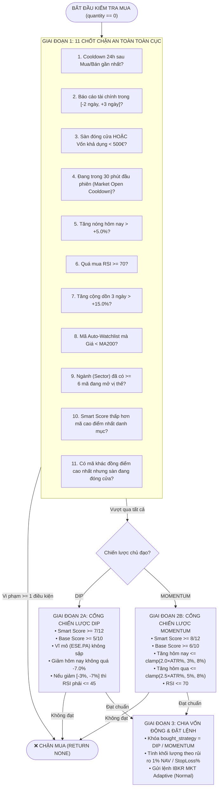

# 🗺️ SCHEMA RA QUYẾT ĐỊNH MUA & BÁN CỦA `pyTrade3`

Tài liệu này trình bày toàn bộ thuật toán của **`pyTrade3`** dưới dạng **Sơ đồ Cấu trúc (Schema & Decision Tree)** giúp tra cứu nhanh luồng chấm điểm, bộ lọc an toàn, quy mô vốn và thứ tự ưu tiên thoát lệnh.

---

## 1. 🏗️ SCHEMA TỔNG QUAN LUỒNG XỬ LÝ (`MAIN LOOP`)

```text
[CHU KỲ QUÉT BOT: check_trading_conditions()]
 │
 ├──► 0. KIỂM TRA HỆ THỐNG
 │     ├─ Có lệnh vừa bị từ chối < 1h trước? ──────────► [DỪNG]
 │     ├─ Đang tải dữ liệu ngầm / Giá <= 0? ───────────► [DỪNG]
 │     └─ Đang bật Manual Mode hoặc Readonly UI? ──────► [CHỈ CẬP NHẬT ĐIỂM & DỪNG]
 │
 ├──► 1. TÍNH ĐIỂM & THAM SỐ ĐỘNG (ATR-BASED)
 │     ├─ Tính Smart Score (0 → 12) & Chọn chế độ: [DIP] hoặc [MOMENTUM]
 │     ├─ Mục tiêu lãi động : dynamic_profit_target = clamp(1.5 × ATR%, min_profit, max_profit)
 │     └─ Cắt lỗ động       : dynamic_stop_loss     = -clamp(2.3 × ATR%, 3.0%, Cap[-7% DIP | -9% MOM])
 │
 ├──► 2. PHÂN NHÁNH QUYẾT ĐỊNH THEO VỊ THẾ
 │     │
 │     ├─► [ĐANG CÓ HÀNG: quantity > 0] ──► Chạy [SCHEMA BÁN (Mục 4)] (Ưu tiên số 1, bỏ qua Cooldown mua)
 │     │
 │     └─► [CHƯA CÓ HÀNG: quantity == 0] ─► Chạy [SCHEMA MUA (Mục 3)] (Qua 11 Cổng lọc + 2 Cổng Chiến lược)
```

---

## 2. 📊 SCHEMA CHẤM ĐIỂM `SMART SCORE` (`0 → 12 ĐIỂM`)

```text
╔══════════════════════════════════════════════════════════════════════════════════════════╗
║  SMART SCORE = clamp(0, 12,  BASE_SCORE  +  ANALYST_MOD  +  TARGET_BONUS  +  ETF_BOOST)  ║
╚══════════════════════════════════════════════════════════════════════════════════════════╝
        │                           │               │               │
        ▼                           ▼               ▼               ▼
┌───────────────────────┐   ┌───────────────┐ ┌───────────────┐ ┌───────────────┐
│ 1. BASE_SCORE (0..10) │   │ 2. ANALYST    │ │ 3. BANK       │ │ 4. ETF/ETC    │
│ max(DIP, MOMENTUM)    │   │ MOD (-2..+3)  │ │ TARGET(-3..+3)│ │ BOOST (+6)    │
└───────────────────────┘   └───────────────┘ └───────────────┘ └───────────────┘
```

### 2.1. Nhánh `BASE_SCORE` (Chọn điểm cao hơn giữa `DIP` và `MOMENTUM`)

```text
                     ┌─── [NHÁNH A: DIP BUYER] (Tối đa 10đ) ───┐
                     │                                         │
                     ├─ 1. RSI (Tối đa +4đ)                    │
                     │   ├─ RSI < 25 ────────────────► +4đ     │
                     │   ├─ RSI < 30 ────────────────► +3đ     │
                     │   └─ RSI < 40 ────────────────► +2đ     │
                     │                                         │
                     ├─ 2. Bollinger Band %B (Tối đa +3đ)      │
                     │   ├─ BB_PctB < 0.0 (Thủng đáy)► +3đ     │
                     │   ├─ BB_PctB < 0.1 ───────────► +2đ     │
                     │   └─ BB_PctB < 0.2 ───────────► +1đ     │
                     │                                         │
                     └─ 3. Xu hướng nền (Tối đa +3đ)           │
                         ├─ Giá > MA200 ─────────────► +3đ     │
                         └─ Giá > Close hôm qua ─────► +1đ     │
                                                               ├──► BASE_SCORE = max(DIP, MOM)
                     ┌─ [NHÁNH B: MOMENTUM] (Tối đa 10đ) ──────┤    (Nếu DIP >= MOM ➔ Chiến lược DIP
                     │                                         │     Ngược lại      ➔ Chiến lược MOM)
                     ├─ 1. MACD (Tối đa +3đ)                   │
                     │   ├─ MACD == S_BULL (>0) ─────► +3đ     │
                     │   └─ MACD == BULL (<=0) ──────► +2đ     │
                     │                                         │
                     ├─ 2. ADX [Chỉ cộng khi Giá > MA50] (+2đ) │
                     │   ├─ ADX > 35 ────────────────► +2đ     │
                     │   └─ ADX > 25 ────────────────► +1đ     │
                     │                                         │
                     ├─ 3. Khối lượng dự phóng (+2đ)           │
                     │   ├─ Proj_Vol > 1.5 × MA14_Vol► +2đ     │
                     │   └─ Proj_Vol > 1.0 × MA14_Vol► +1đ     │
                     │                                         │
                     └─ 4. Vùng RSI xung lực (+3đ)             │
                         ├─ 50 <= RSI <= 70 ─────────► +3đ     │
                         └─ 40 <= RSI <  50 ─────────► +1đ     │
```

### 2.2. Nhánh Điểm Cộng / Trừ Định Giá (`ANALYST_MOD` + `TARGET_BONUS` + `ETF_BOOST`)

```text
├──► [2. ANALYST_MOD (-2 → +3đ)] (Trọng số độ mới 90 ngày, Tier 1 nhân đôi)
│     ├─ Upside trung bình > +20% ─────────► +3đ (nếu tổng trọng số > 2) hoặc +2đ
│     ├─ Upside trung bình > +10% ─────────► +1đ
│     └─ Downside          < -5%  ─────────► -2đ (Overvalued)
│
├──► [3. TARGET_BONUS (-3 → +3đ)] (So sánh Giá hiện tại với Giá mục tiêu Ngân hàng / Yahoo)
│     ├─ Giá <= 80% Target (Rẻ hơn >=20%) ─► +3đ
│     ├─ Giá <= 90% Target (Rẻ hơn >=10%) ─► +2đ
│     ├─ Giá < 100% Target (Dưới Target)  ─► +1đ
│     ├─ Giá > 100% Target (Vượt Target)  ─► -1đ
│     ├─ Giá >= 110% Target (Đắt >=10%)   ─► -2đ
│     └─ Giá >= 120% Target (Đắt >=20%)   ─► -3đ
│
└──► [4. ETF_BOOST (+6đ)]
      └─ Nếu asset_type thuộc [ETF, ETC] (ESE.PA, EGLN.L, SPCX) ──► +6đ
```

---

## 3. 🟢 SCHEMA QUYẾT ĐỊNH MUA (`BUY DECISION TREE`)

Để phát lệnh **`BUY`**, cổ phiếu phải đi qua **Phễu 3 Giai Đoạn** mà không bị chặn ở bất kỳ nhánh nào:



### Chi Tiết Công Thức Chia Vốn Động (Giai đoạn 3 — [`_calculate_dynamic_max_amount()`](file:///Users/canhhung/Documents/pyTrade3/trading_bot.py#L675-L721))

```text
[TÍNH QUY MÔ VỐN TỐI ĐA CHO 1 MÃ]
 ├─ 1. Rủi ro cho phép mỗi lệnh : Risk_EUR = Tổng_Tài_Khoản × 1.0% (Mặc định: 14,000€ × 1% = 140€)
 ├─ 2. Khoảng cách Cắt lỗ       : Stop_Dist = max(1%, |dynamic_stop_loss| / 100)
 ├─ 3. Hạn mức vốn theo ATR     : Dynamic_Max = Risk_EUR / Stop_Dist
 ├─ 4. Áp trần tỷ trọng danh mục:
 │     ├─ Cổ phiếu thường (STOCK) : Tối đa 18% Tổng_Tài_Khoản
 │     └─ Quỹ chỉ số (ETF / ETC)  : Tối đa 35% Tổng_Tài_Khoản
 └─ 5. Số tiền giải ngân thực tế : min(Dynamic_Max, Cash_Left_Của_Mã, IBKR_Usable_Cash) × 0.98
```

---

## 4. 🔴 SCHEMA QUYẾT ĐỊNH BÁN (`SELL PRIORITY TREE`)

Khi đang nắm giữ cổ phiếu (`quantity > 0`), bot kiểm tra từ trên xuống dưới theo **Thứ tự Ưu tiên Tuyệt đối** (chạm điều kiện nào trước sẽ kích hoạt **`SELL`** ngay tại đó):

```text
[BẮT ĐẦU KIỂM TRA BÁN (quantity > 0)]
 │
 ├──► CHỐT CHẶN BẢO VỆ TRƯỚC BÁN (PRE-SELL GUARDS)
 │     ├─ 1. Đang trong 30 phút đầu phiên mở cửa? ───────────────► [TẠM HOÃN BÁN (Tránh nhiễu giá ATO)]
 │     └─ 2. Mua trong hôm nay (Day-Trade) & Chạm trần luật PDT? ► [GIỮ LỆNH QUA ĐÊM (Tránh khóa TK 90 ngày)]
 │
 ├──► ƯU TIÊN 1: CHỐT LỜI ĐỘNG THEO ATR (Dynamic ATR Trailing Profit Lock)
 │     ├─ Điều kiện mở khóa : Lãi đỉnh (highest_pnl) >= dynamic_profit_target
 │     ├─ Độ lùi cho phép   : trail_drop = clamp(0.5 × ATR%,  min=0.5%,  max=1.5%)
 │     └─ Kích hoạt BÁN khi : pnl_percent <= highest_pnl - trail_drop  ────────────────► 🔴 [SELL: TRAILING PROFIT]
 │
 ├──► ƯU TIÊN 2: KHÓA LÃI BẢO VỆ 75% ĐỈNH (Proportional Protective Stop)
 │     ├─ Điều kiện mở khóa : Chưa chạm Ưu tiên 1 NHƯNG highest_pnl >= +5.0%
 │     ├─ Sàn bảo vệ lãi    : protective_floor = highest_pnl × 0.75 (Chỉ cho phép lùi 25% từ đỉnh)
 │     └─ Kích hoạt BÁN khi : pnl_percent <= protective_floor  ────────────────────────► 🔴 [SELL: PROTECTIVE STOP]
 │
 ├──► ƯU TIÊN 3: CẮT LỖ ĐỘNG THEO ATR & CHIẾN LƯỢC LÚC MUA (Dynamic ATR Stop Loss)
 │     ├─ Ngưỡng cắt lỗ     : dynamic_stop_loss = -clamp(2.3 × ATR%, min=3.0%, max=Cap)
 │     │                      • Nếu lúc mua là [DIP]      ➔ Cap = -7.0%
 │     │                      • Nếu lúc mua là [MOMENTUM] ➔ Cap = -9.0%
 │     └─ Kích hoạt BÁN khi : pnl_percent <= dynamic_stop_loss ────────────────────────► 🔴 [SELL: ATR STOP LOSS]
 │
 ├──► ƯU TIÊN 4: CHỐT LỜI KHI RSI QUÁ MUA CỰC ĐỘ (RSI Overbought Exit)
 │     └─ Kích hoạt BÁN khi : RSI >= 80  VÀ  pnl_percent > +1.0% ──────────────────────► 🔴 [SELL: RSI OVERBOUGHT]
 │
 ├──► ƯU TIÊN 5: THOÁT LỆNH KHI MACD ĐẢO CHIỀU GIẢM (MACD Bearish Crossover)
 │     └─ Kích hoạt BÁN khi : MACD chuyển từ [BULL / S_BULL] ➔ [BEAR / S_BEAR]
 │                            VÀ pnl_percent > +1.0% ──────────────────────────────────► 🔴 [SELL: MACD CROSSOVER]
 │
 ├──► ƯU TIÊN 6: CHỐT LỜI KHI VƯỢT XA GIÁ MỤC TIÊU NGÂN HÀNG (Analyst Target Exit)
 │     └─ Kích hoạt BÁN khi : Giá thị trường >= 110% Giá mục tiêu (Target)
 │                            VÀ pnl_percent > +0.5% ──────────────────────────────────► 🔴 [SELL: ANALYST TARGET]
 │
 └──► ƯU TIÊN 7: CẮT LỆNH NGÂM VỐN QUÁ HẠN (Time-Stop Stagnation Exit)
       └─ Kích hoạt BÁN khi : Số ngày nắm giữ (held_days) >= 25 ngày
                              VÀ pnl_percent <= -0.5% ─────────────────────────────────► 🔴 [SELL: TIME-STOP 25D]
```

---

## 5. 📋 BẢNG TRA CỨU NHANH THAM SỐ CỐT LÕI (`QUICK CHEATSHEET`)

| Nhóm quy tắc | Tham số / Biến số | Ngưỡng áp dụng | Tác dụng trong hệ thống |
| :--- | :--- | :---: | :--- |
| **Điểm vào lệnh (`Entry`)** | `DIP` (Two-Gate) | `Smart >= 7` & `Base >= 5` | Bắt đáy cổ phiếu khỏe đang chỉnh ngắn hạn |
| **Điểm vào lệnh (`Entry`)** | `MOMENTUM` (Two-Gate) | `Smart >= 8` & `Base >= 6` | Đánh bứt phá khi MACD + ADX + Vol đồng thuận |
| **Chống mua đuổi (`FOMO`)** | `daily_change` / `3d_change` | `<= +5.0%` / `<= +15.0%` | Chặn mua khi giá đã chạy quá xa nền |
| **Chống bắt dao rơi** | `daily_drop` (`DIP`) | `>= -7.0%` (`RSI <= 45` nếu `< -3%`) | Tránh mua cổ phiếu sập gãy cấu trúc trong 1 phiên |
| **Đa dạng hóa danh mục** | `MAX_SECTOR_POSITIONS` | Tối đa `6 mã / ngành` | Ngăn rủi ro sập đồng loạt một nhóm ngành |
| **Thời gian nghỉ (`Cooldown`)** | `Market Open` / `Trade Gap` | `30 phút` đầu phiên / `24 giờ` | Chống nhiễu giá mở cửa & chống giao dịch quá mức |
| **Bảo vệ lợi nhuận** | `Trailing` / `Protective` | Lùi `0.5%–1.5%` / Giữ `75%` lãi đỉnh | Không để lệnh thắng lớn (>5%) biến thành lệnh thua |
| **Giới hạn cắt lỗ (`Stop Cap`)** | `dynamic_stop_loss` | `-3.0%` đến `-7.0%` (`DIP`) / `-9.0%` (`MOM`) | Khóa chặt mức lỗ tối đa theo đúng bản chất chiến lược |
| **Vòng quay vốn (`Time-Stop`)** | `TIME_STOP_DAYS` | `>= 25 ngày` & `PnL <= -0.5%` | Giải phóng vốn bị kẹt ở cổ phiếu đi ngang |
