# 🏛️ TÀI LIỆU KIẾN TRÚC BACKEND 5 KHỐI LEAN (`pyTrade3`)

> **Mô hình chuẩn hóa:** Lấy cảm hứng từ hạ tầng thuật toán định lượng số 1 thế giới **Lean (QuantConnect)**.  
> **Mục tiêu:** Xóa bỏ mã nguồn monolithic cồng kềnh, phân tách rành mạch 5 khối trách nhiệm độc lập, đảm bảo **100% tính nhất quán** giữa Live Bot và Backtest Benchmark.

---

## 🗺️ 1. SƠ ĐỒ TỔNG THỂ VÀ LUỒNG DỮ LIỆU (LIFE OF A TRADING TICK)

Mỗi chu kỳ kiểm tra điều kiện giao dịch (`check_trading_conditions`), dữ liệu di chuyển theo **đồ thị 1 chiều tuần tự**, tuyệt đối không có vòng lặp phụ thuộc (Acyclic Dependency Graph):

```mermaid
sequenceDiagram
    autonumber
    participant GUI as GUI / Display Loop
    participant Facade as trading_bot.py (Facade)
    participant DF as 1. DataFeed (data_feed.py)
    participant RM as 4. RiskManagement (risk_manager.py)
    participant AC as 2. AlphaCreation (alpha_engine.py)
    participant PC as 3. PortfolioSizing (portfolio_sizing.py)
    participant EX as 5. Execution (execution.py)
    participant IB as Broker (IBKR TWS / Gateway)

    GUI->>Facade: check_trading_conditions()
    Facade->>DF: get_snapshot()
    DF-->>Facade: MarketSnapshot (RSI, ADX, MACD, BB, ATR, Vol...)
    
    rect rgb(45, 25, 25)
    Note over Facade,RM: ƯU TIÊN BẢO VỆ VỐN: Đánh giá Thoát lệnh (Exit) trước
    Facade->>RM: evaluate_exit(snapshot, position, ATR stop, targets...)
    alt Thỏa mãn 1 trong 7 Sell Triggers
        RM-->>Facade: ('SELL', Reason)
        Facade->>EX: place_sell_order()
        EX->>IB: Gửi lệnh SELL MKT Adaptive
    end
    end

    rect rgb(25, 35, 45)
    Note over Facade,AC: TÌM KIẾM CƠ HỘI: Tính điểm định lượng
    Facade->>AC: calculate_score(snapshot, analyst_data, bank_note)
    AC-->>Facade: AlphaSignal (DIP / MOMENTUM, Score 0-12)
    end

    rect rgb(45, 40, 25)
    Note over Facade,RM: NGƯỜI GÁC CỔNG SẮT: Kiểm tra 13 Hard Buy Guards
    Facade->>RM: validate_buy(snapshot, AlphaSignal, cash...)
    alt Bị chặn bởi bất kỳ Guard nào
        RM-->>Facade: RiskDecision(allowed=False, reason=...)
    else Đủ điều kiện Mua
        RM-->>Facade: RiskDecision(allowed=True, action='BUY')
        Facade->>PC: calculate_order_sizing(cash, price, FX...)
        PC-->>Facade: (Quantity, Cost EUR, Limit)
        Facade->>EX: place_buy_order(quantity, price...)
        EX->>IB: Gửi lệnh BUY MKT Adaptive
    end
    end
```



---

## 📂 2. DANH MỤC CHI TIẾT CÁC FILE TRONG `backend/`

### 📁 Thư mục `backend/services/` (Lõi 5 Khối Định Lượng Lean)

#### 1. `backend/services/models.py` — Giao thức Giao tiếp DTO (Data Contracts)
* **Nhiệm vụ:** Định nghĩa các Data Class bất biến dùng để trao đổi dữ liệu giữa các service mà không làm các file bị phụ thuộc chéo vào nhau:
  * `MarketSnapshot`: Chứa toàn bộ thông số giá nến, RSI, ADX, MACD, Bollinger Bands, ATR, khối lượng và thông tin ngành/tiền tệ.
  * `AlphaSignal`: Chứa kết quả chấm điểm định lượng (Strategy, Smart Score 0-12, Base Score 0-10, Upside %).
  * `RiskDecision`: Chứa phán quyết của bộ kiểm soát rủi ro (`allowed=True/False`, `reason`).
  * `OrderIntent`: Chứa thông số cấu hình lệnh đã được định cỡ hoàn chỉnh để đưa sang broker.

#### 2. `backend/services/data_feed.py` — Khối 1: DataFeed Service
* **Nhiệm vụ:**
  * Lấy dữ liệu giá nến thời gian thực và lịch sử 1 năm từ Yahoo Finance / IBKR.
  * Tính toán toàn bộ các chỉ báo kỹ thuật: **RSI (Wilder 14), ADX 14, MACD (12, 26, 9), MA20/MA50/MA200, Bollinger Bands (%B), ATR 14**.
  * Quản lý bộ nhớ đệm 2 tầng (RAM cache + SQLite `cached_indicators`).
  * Tính khối lượng dự phóng trong ngày (`get_projected_volume()`).
  * Kiểm tra giờ mở/đóng cửa và vùng thời gian hạ nhiệt mở phiên (`is_market_cooling_down()` 30 phút).

#### 3. `backend/services/alpha_engine.py` — Khối 2: AlphaCreation Engine
* **Nhiệm vụ:**
  * Lõi toán học định lượng tính **`smart_score` (0 đến 12 điểm)** cho 2 chế độ chiến lược:
    * **Chiến lược A (DIP Buyer):** RSI quá bán + Bollinger Band chạm đáy + Xu hướng nền tảng.
    * **Chiến lược B (MOMENTUM Breakout):** MACD Bullish + ADX xu hướng mạnh + Đột biến khối lượng + RSI sweet spot (50-70).
  * Chấm điểm điều chỉnh định giá ngân hàng lớn (`calculate_analyst_modifier()`) dựa trên giá mục tiêu UBS, Barclays, Morgan Stanley với cơ chế suy giảm theo thời gian (90-day decay).
  * Cộng điểm nền tảng ETF/ETC Boost (+6 điểm).
  * Cơ chế kiểm tra hai cổng (Two-gate filter): Ngăn chặn việc điểm chuyên gia gánh một tín hiệu kỹ thuật yếu.

#### 4. `backend/services/portfolio_sizing.py` — Khối 3: PortfolioConstruction Service
* **Nhiệm vụ:**
  * *Đã tích hợp `ExchangeRateManager` và tính toán PnL danh mục:* Quản lý chuyển đổi tỷ giá ngoại tệ trực tiếp: EUR, USD, GBP, CAD, HKD.
  * Tính toán kích thước vị thế động (`calculate_dynamic_max_amount()`) dựa trên quy mô tài khoản thực, tỷ lệ rủi ro/lệnh (% Risk per trade) và khoảng cách cắt lỗ ATR.
  * Khống chế trần phân bổ tài sản: Tối đa 35% tài khoản cho ETF/ETC, tối đa 18% cho cổ phiếu đơn lẻ.
  * Áp dụng đệm an toàn vốn `CASH_BUFFER_MULTIPLIER = 0.95`.

#### 5. `backend/services/risk_manager.py` — Khối 4: RiskManagement Engine
* **Nhiệm vụ:**
  * *Đã tích hợp `PDTProtector`:* Người gác cổng sắt thi hành **13 Hard Buy Guards** và **7 Exit Triggers**.

#### 6. `backend/services/execution.py` — Khối 5: Execution Service
* **Nhiệm vụ:**
  * Phân giải sàn giao dịch và tiền tệ gốc dựa trên mã cổ phiếu.
  * Gửi lệnh thị trường thích ứng (`Adaptive Market Order`) thông qua IBKR Socket, quản lý timeout 300s, cập nhật CSV/DB và kích hoạt gửi Email.

---

### 📄 Thư mục gốc `backend/` (Chỉ còn 7 File Cốt Lõi + 1 Thư mục Services)
* **Số dòng:** ~580 dòng *(đã tinh gọn từ 1.634 dòng monolithic)*.
* **Nhiệm vụ:**
  * Đóng vai trò lớp vỏ bọc tương thích ngược (Facade Pattern).
  * Ủy quyền (Delegate) các thuộc tính và hàm ra bên ngoài để [frontend/gui.py](file:///Users/canhhung/Documents/pyTrade3/frontend/gui.py) và [workers.py](file:///Users/canhhung/Documents/pyTrade3/frontend/workers.py) truy cập như cũ (`bot.smart_score`, `bot.rsi_value`, `bot.pnl_percent`, v.v.) mà không cần phải thay đổi giao diện.

---

### 8. Các File Hạ Tầng & Vệ Tinh Khác
* **`backend/database.py`:** Quản lý cơ sở dữ liệu SQLite cục bộ, tự động nâng cấp schema (`PRAGMA user_version`) và sao lưu phục hồi chống lỗi file hỏng.
* **`backend/analyst_scraper.py`:** Trích xuất tự động phân tích và khuyến nghị từ UBS, Yahoo Finance.
* **`backend/notifier.py`:** Gửi thông báo Email SMTP khi lệnh khớp hoặc khi mất/kết nối lại IBKR.
* **`backend/ibkr_watchdog.py`:** Giám sát socket kết nối IBKR TWS/Gateway và tự động kết nối lại khi rớt mạng.
* **`backend/config.py`:** Biến môi trường, logger tập trung và ThreadPoolExecutor.

---

## 🛠️ 3. HƯỚNG DẪN KHI BẠN CẦN CHỈNH SỬA HOẶC NÂNG CẤP

| Khi bạn muốn làm việc gì? | Bạn chỉ cần mở duy nhất file này |
| :--- | :--- |
| **Thêm Chiến lược mới (Strategy C: Mean Reversion, VWAP Breakout...)** | [backend/alpha_engine.py](file:///Users/canhhung/Documents/pyTrade3/backend/alpha_engine.py) |
| **Chỉnh sửa luật Chốt lời, Cắt lỗ hoặc thêm Hard Guard chặn mua** | [backend/risk_manager.py](file:///Users/canhhung/Documents/pyTrade3/backend/risk_manager.py) |
| **Thay đổi công thức tính chỉ báo (RSI, ADX, MACD, Volume)** | [backend/data_feed.py](file:///Users/canhhung/Documents/pyTrade3/backend/data_feed.py) |
| **Điều chỉnh quy tắc phân bổ vốn hoặc thêm sàn tiền tệ mới** | [backend/portfolio_sizing.py](file:///Users/canhhung/Documents/pyTrade3/backend/portfolio_sizing.py) |
| **Thay đổi loại lệnh gửi sang IBKR (Limit thay vì Market Adaptive)** | [backend/execution.py](file:///Users/canhhung/Documents/pyTrade3/backend/execution.py) |

> [!IMPORTANT]
> **Quy trình nghiệm thu sau mỗi lần sửa code:**
> Luôn chạy lệnh kiểm tra tự động trước khi triển khai thực tế:
> ```bash
> ./scripts/verify_py.sh
> ```
> Script này sẽ biên dịch cú pháp 100% file, quét biến ma, kiểm tra tính toàn vẹn của database SQLite và tự động vẽ lại bản đồ dòng code trong [docs/CODEBASE_MAP.md](file:///Users/canhhung/Documents/pyTrade3/docs/CODEBASE_MAP.md).

